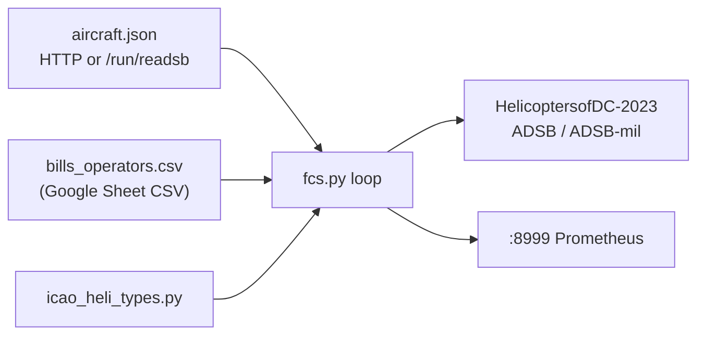
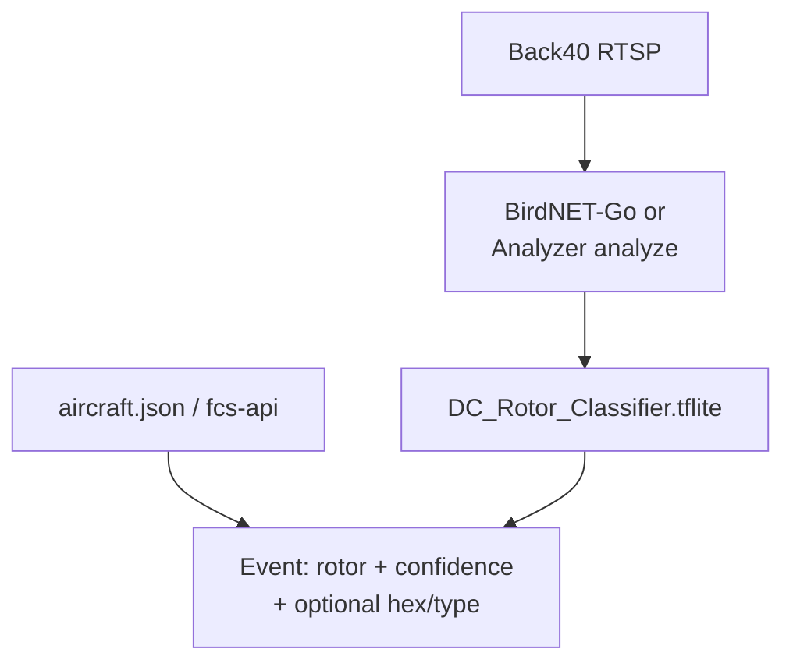

# FCS roadmap: review, brauhaus integration, heli-audio, and query API

**Status:** Planning (2026-10-23) — return to implementation later.  
**Repo:** LoganSound/CopterFeeder (`fcs.py`, v26.3.1, `CODE_DATE` 20260208).  
**Related brauhaus infra:** picm3 adsb.im feeder, stage2 VM (`192.168.64.147`), nobel vhost
`adsb.brauhausdc.org` → `/data/aircraft.json`, Mongo Atlas `HelicoptersofDC-2023` (`ADSB`,
`ADSB-mil`).

---

## 1. What FCS does today



| Step | Behavior |
| ---- | -------- |
| Input | `http://{SERVER}:{PORT}/data/aircraft.json` or local `/run/{dump1090,readsb,...}/aircraft.json` with `-r` |
| Heli gate | Requires **`t` in `icao_heli_types`** (~900 type strings) |
| Enrichment | Bills CSV (hex → operator); callsign from `flight`; reg from `r` or Bills |
| Freshness | Skips stale `seen_pos` vs poll interval (Compose: `-i 15`) |
| Output | GeoJSON `Feature` → MongoDB driver insert (preferred) or legacy HTTPS API |
| Metrics | Prometheus on **8999**; optional OTLP via `docker-entrypoint.sh` |

**Query gap:** Consumers today hit **MongoDB Atlas** directly, **Grafana** (feeder metrics),
or duplicate **aircraft.json** polling. There is no first-class HTTP API on FCS for
“helicopters near me in the last N minutes” or “active rotors for feeder X.”

---

## 2. Code review summary (2026-10-23)

### Strengths

- MongoClient pooling, SIGTERM cleanup, mil split (`dbFlags & 1` → `ADSB-mil`).
- Bills refresh on interval (`BILLS_TIMEOUT`, default 3600 s).
- Docker + kube dev/prod + buildx multi-arch.

### Issues to fix (when we implement)

| ID | Severity | Item |
| -- | -------- | ---- |
| R1 | Functional | Comments say **A7 / Bills** path; code only accepts **`t` in `icao_heli_types`**. Category A7 or Bills-only hex without matching `t` is dropped. |
| R2 | Bug | `-V` prints literal `{VERSION}` (missing `f` on format string). |
| R3 | Bug | `mongo_https_insert`: `HTTPError` path may reference undefined `response`. |
| R4 | Bug | `load_helis_from_url` success return may use stale `bills_age` instead of `tmp_bills_age`. |
| R5 | Ops | Dockerfile **HEALTHCHECK** calls `/health`; Prometheus `start_http_server` typically exposes **`/metrics` only**. |
| R6 | Security | `kube/prod/fcs-env-configmap.yaml` has **plaintext `MONGOPW`** in git — rotate, use **Secret**, scrub history if exposed. |
| R7 | Ops | `fcs_rx_msgs` labels **icao + callsign** — high cardinality on busy feeds. |
| R8 | Maintainability | ~2100-line monolith — hard to unit-test filter/insert logic. |

### Product decision (rotor filter)

When implementing, choose explicit rules, e.g.:

- `category == "A7"`, **or**
- `t in icao_heli_types`, **or**
- `t` prefix `H` (ICAO heli family), **or**
- hex present in Bills with rotor intent

Document the chosen rule in `AGENTS.md` and tests.

---

## 3. Brauhaus deployment (no local SDR required)

FCS can run anywhere that reaches the merged sky picture:

| Setting | Example |
| ------- | ------- |
| `FEEDER_ID` | `dhb-test`, `brauhaus-back40`, etc. (must match Grafana `_helifeeder`) |
| `SERVER` | `adsb.brauhausdc.org` |
| `PORT` | `80` |
| `MONGOUSER` / `MONGOPW` | Atlas user for `HelicoptersofDC-2023` (via Secret, not ConfigMap) |

**Colocated on picm3:** `-r` and mount ultrafeeder/readsb `aircraft.json` under `/run/...`.

**Remote (e.g. Back40 Pi, k8s):** HTTP URL only; same Mongo feeder id for correlation.

---

## 4. Helicopter **audio** fusion (separate from FCS, shared ADS-B)

Goal: combine **RTSP microphone** (e.g. Back40 UniFi) with **ADS-B** to label helicopter
passages and reduce false positives (BirdNET / custom ONNX).

| Layer | Role |
| ----- | ---- |
| **FCS** | Authoritative **track → Mongo** for HoDC map; hex, type, callsign, feeder, time, geometry |
| **Heli-audio service** (future repo e.g. `heli-audio`) | Audio pipeline + **correlator** keyed on time + feeder + optional distance |
| **BirdNET / Perch** | Weak “aircraft/engine” hints only; Perch has no dedicated helicopter class |

**Phase 1 correlator inputs (pick one or combine):**

1. Poll same `aircraft.json` as FCS (simplest).
2. Query Mongo by `properties.feeder` + `properties.jsDate` window (matches existing Grafana heatmaps).
3. **Future:** query **FCS Query API** (section 5) — preferred once API exists.

**Phase 2+:** Custom **helicopter audio classifier** (BirdNET-Analyzer or similar), ADS-B-assisted
labeling, optional dedicated ONNX; deploy via brauhaus `multiarch-builder`.

**Note (pirak07 BirdNET):** Shorebird/screech-owl tuning is independent; keep mammals/amphibians
user wanted; FCS does not replace audio classifiers.

### 4.1 Rotorcraft commonly heard near Arlington / DC

Arlington County **does not operate** its own police helicopter; aviation there is mostly **UAS
(drones)**. Overhead rotor noise at Back40 / brauhaus (38.87°N, 77.11°W) is dominated by **NCR
public-safety, medevac, military, and news** traffic tracked on [Helicopters of DC](https://helicoptersofdc.com/)
and **CopterSpotter / FCS** (ADS-B).

| Operator / program | Typical types | Call signs / notes | HoDC / ADS-B |
| ------------------ | ------------- | ------------------ | ------------ |
| **US Park Police Aviation** (Eagle’s Nest, Anacostia) | Bell **412EP** (ops), Bell **206** (training/backup) | **Eagle**; primary **DC scene medevac** per DC Fire & EMS protocol | [HoDC entry](https://helicoptersofdc.com/) |
| **Fairfax County PD** Helicopter Division | Bell **429** (×2) | **Fairfax 1** on ATC | Over Arlington often |
| **MPD Air Support (Falcon)** | **Airbus H125** (2024+; was Eurocopter AS350B3) | **Falcon 1**, **Falcon 2** | Surveillance / SAR |
| **MedSTAR** (MedStar Health) | **Airbus EC135** family | **MedSTAR 1–3**; bases incl. **Tipton (Fort Meade)**, Indian Head, St. Mary’s | AIM example: “MEDEVAC Medstar One” |
| **Maryland State Police** (Trooper 2 @ JBA) | **Leonardo AW139** | **TRP2**, TRP3, …; medevac into DC hospitals | Frequent in DC metro |
| **Children’s National** | (SkyBear program) | Neonatal / peds transfers | HoDC “SkyBear” |
| **HMX-1 (Marine One)** | **VH-3D**, **VH-60N**, **VH-92A**, MV-22 | **Marine One** formations; Ellipse ↔ JBA/Quantico | Very distinctive; paired/triple ship |
| **US Army 12th Aviation Battalion** | UH-60 / similar | Fort Belvoir / DC overflights | Mil ADS-B |
| **USAF 1st Helicopter Squadron** | UH-1N / successor | Andrews / VIP support | Mil |
| **USCG Air Station Atlantic City** | MH-65 | SAR / security | Occasional |
| **CBP Air & Marine** | Various | Border / enforcement | Occasional |
| **Shared DC news pool** | Bell **206L-4** etc. | **News 1** on airband; tails **N98CL**, **N67CL**, **N9QD** | Traffic / breaking news |
| **Prince George’s County PD** | (aviation unit) | Law enforcement | PG county |

**Model scope (recommended v1):** start with **binary** classes (`Rotorcraft`, `Background`) plus
optional **coarse buckets** (`Light_single`, `Twin_engine_public_safety`, `Military_heavy`,
`News_light`) before per-type IDs (412 vs EC135 vs H125). Full type-level ID needs many labeled
clips per ICAO type and benefits from **FCS hex → type** at training time.

**Negative / confuser audio (local):** sirens (already in BirdNET-Go classifiers), fixed-wing
(Reagan National arrivals), drones (Arlington PD/Fire UAS — different spectrum/time profile),
traffic, construction.

### 4.2 **[BirdNET-Analyzer](https://github.com/birdnet-team/BirdNET-Analyzer)** custom classifier

Official docs: [Training custom classifiers](https://birdnet-team.github.io/BirdNET-Analyzer/stable/best-practices/training.html),
[CLI `birdnet_analyzer.train`](https://birdnet-team.github.io/BirdNET-Analyzer/stable/usage/cli.html).

**Why BirdNET-Analyzer:** Documented path for **non-bird** labels; trains a **new classifier head**
on frozen BirdNET **embedding** model (transfer learning). Works with folder-per-class WAV data,
48 kHz, 3 s segments; supports **Background / Noise / Silence** non-event folders and **negative
sample** folders (`-ClassName`).

**Training workflow (helicopter-specific):**

```text
dataset/
├── Background/              # yard, traffic, birds, no rotor
├── Noise/                   # optional alias non-event
├── Rotorcraft_Helicopter/   # generic heli (bootstrap)
├── Bell_412_Public_Safety/  # optional fine classes
├── EC135_Medevac/
├── AS350_H125_Light/
├── UH60_Black_Hawk/
└── ...
```

```bash
python -m birdnet_analyzer.train dataset/ \
  -o checkpoints/dc-rotor/DC_Rotor_Classifier.tflite \
  --autotune   # optional; needs keras-tuner
python -m birdnet_analyzer.analyze clips/ \
  --classifier checkpoints/dc-rotor/DC_Rotor_Classifier.tflite
```

**`model_save_mode`:**

| Mode | Use case |
| ---- | -------- |
| **`replace`** | **Heli-only** detector (no bird list) — good for dedicated heli-audio service |
| **`append`** | Keep full BirdNET species **plus** rotor classes — one model for pirak07 if RAM/CPU allows |

Custom classifiers are **[CC BY-NC-SA 4.0](https://birdnet-team.github.io/BirdNET-Analyzer/stable/usage/cli.html)** —
confirm compliance if deploying beyond personal/LAN research.

**Hyperparameters:** defaults (50 epochs, batch 32, val split 0.2); tune **`fmin`/`fmax`** if focusing
main rotor band; use **`--crop_mode smart`** for long RTSP-derived clips.

### 4.3 Similar / complementary tooling

| Tool | Role |
| ---- | ---- |
| **[BirdNET-Go](https://github.com/tphakala/birdnet-go)** + **[birdnet-go-classifiers](https://github.com/tphakala/birdnet-go-classifiers)** | **Runtime on pirak07 today** — load custom `.tflite` + `*_Labels.txt` via `config.yaml` `modelpath` / `labelpath` |
| **Perch v2 (ONNX)** in BirdNET-Go | Broad “Aircraft” / “Engine” weak signal — **not** helicopter-specific |
| **[AeroSonicDB 3K](https://zenodo.org/records/12775560)** | ~**0.5 h** labeled rotorcraft + 31 h fixed-wing; 16 kHz; ICAO metadata — bootstrap + pretrain |
| **MAD dataset** (helicopter class, YouTube-sourced) | ~1k helicopter clips — domain shift vs suburban mic; use cautiously |
| **DroneAudioSet** | Drones, not full-size helis — skip for this project |
| **Custom CNN / YAMNet / PANNs** | If BirdNET embeddings insufficient — heavier ops; defer until baseline measured |

**Export path:** Train in BirdNET-Analyzer → **TFLite** → BirdNET-Go on Pi or **sidecar** inference
container on k8s (amd64 GPU optional).

### 4.4 Training data strategy (Back40 + ADS-B)

1. **Auto-label windows:** When FCS or local `aircraft.json` shows rotor within X km and |alt| &lt; Y ft,
   slice RTSP audio ±30–60 s → positive folder; label with **`type` / operator** from ADS-B when confident.
2. **Hard negatives:** Same windows when **no** rotor on JSON; siren-heavy clips from pirak07 BirdNET DB.
3. **Public audio (verify license):**
   - [Freesound — Marine One near Washington Monument](https://freesound.org/people/blaukreuz/sounds/211940/) (field recording, check license on page)
   - [Freesound — qubodup rotor loop (CC0, US gov video extract)](https://freesound.org/people/qubodup/sounds/187681/)
   - [Freesound — UnderlinedDesigns rotor / military rotor CC0](https://freesound.org/people/UnderlinedDesigns/sounds/436449/) — synthetic; use only as augment, not sole positive
4. **AeroSonicDB** rotor subclass — map **`aircraft_meta.csv`** ICAO types to our DC buckets; resample 16→48 kHz for BirdNET.
5. **Manual spot checks:** Cross-check with [Helicopters of DC](https://helicoptersofdc.com/) operator pages and HoDC Mongo sightings.

Target: **≥100 clips per class** (BirdNET recommendation); until then prioritize **binary rotor vs not**
with heavy **Background**.

### 4.5 Inference integration (with FCS)



- **Gate:** fire “helicopter audio” alert only when classifier **and** (optional) ADS-B correlator agree
  within Δt — reduces sirens and distant fixed-wing.
- **FCS Query API:** `GET /v1/helicopters/near?lat=…&since=5m` supplies hex/type for alert text and
  training metadata loop.

### 4.6 ML implementation phases

| Phase | Deliverable |
| ----- | ----------- |
| **M0** | Dataset layout repo; scripts to clip RTSP from ADS-B triggers; Background collection |
| **M1** | BirdNET-Analyzer **binary** `Rotorcraft` vs `Background`; evaluate on held-out Back40 nights |
| **M2** | **Append** or replace mode decision; deploy TFLite to pirak07 BirdNET-Go test stack |
| **M3** | Coarse multi-class (412 / EC135 / H125 / military / news); ADS-B auto-label audit set |
| **M4** | Optional export to ONNX if moving off BirdNET-Go; correlate with FCS **feeder** timelines in Grafana |

---

## 5. Proposed: **FCS Query API** (FastAPI)

### 5.1 Motivation

- **Heli-audio** and other clients need stable, documented HTTP access without Mongo wire protocol.
- **Read path** should not run in the hot ADS-B loop (avoid blocking inserts).
- **OpenAPI** enables codegen and agent tooling (MCP, scripts).

### 5.2 Recommended architecture

**Separate process (or container sidecar): `fcs-api`**

```
┌─────────────┐     insert      ┌──────────┐
│  fcs.py     │ ──────────────► │ MongoDB  │
│  (writer)   │                 │ Atlas    │
└─────────────┘                 └────▲─────┘
                                     │ read
                               ┌─────┴─────┐
                               │  fcs-api  │
                               │  FastAPI  │
                               │  :8080    │
                               └───────────┘
                                     ▲
                               heli-audio, Grafana
                               plugins, curl, agents
```

Optional **in-memory cache** in `fcs-api`: subscribe to periodic refresh of `aircraft.json`
(per feeder) for **live** “rotors in JSON now” without waiting for Mongo insert latency.

Do **not** fold heavy query logic into `fcs.py` loop; share library code via a small package
(e.g. `fcs_common/` or `src/feedcopterspotter/`) for filter rules and GeoJSON parsing.

### 5.3 Tech stack

| Piece | Choice |
| ----- | ------ |
| Framework | **[FastAPI](https://fastapi.tiangolo.com/)** + **Uvicorn** (already common in Python 3.12 images) |
| Mongo | **`motor`** (async) or sync **`pymongo`** in thread pool — match existing `fcs.py` driver usage |
| Config | Reuse `.env` keys: `MONGOUSER`, `MONGOPW`, `MONGO_URI` / cluster host; add `FCS_API_PORT`, `FCS_API_KEY` |
| Docs | Auto `/docs`, `/redoc`; export OpenAPI JSON for clients |
| Metrics | Prometheus `/metrics` on API (separate from FCS :8999) or single scrape target with labels |

Add to `requirements.txt` (or `requirements-api.txt` extra):

```text
fastapi>=0.115
uvicorn[standard]>=0.32
```

### 5.4 Endpoint sketch (v1)

All times ISO-8601 UTC; responses GeoJSON `FeatureCollection` unless noted.

| Method | Path | Purpose |
| ------ | ---- | ------- |
| `GET` | `/health` | Liveness + Mongo ping (fixes k8s health pattern for API container) |
| `GET` | `/ready` | Mongo + optional aircraft.json reachability |
| `GET` | `/v1/helicopters/recent` | Query params: `feeder`, `since` (duration or timestamp), `limit`, `mil=false\|true` |
| `GET` | `/v1/helicopters/{icao}` | Latest feature for hex (optional `feeder`) |
| `GET` | `/v1/helicopters/near` | `lat`, `lon`, `radius_km`, `since` — Mongo `$geoWithin` or `$near` on stored geometry |
| `GET` | `/v1/live/rotors` | Optional: filter current `aircraft.json` with **same rotor rules as FCS** (configurable URL per feeder) |
| `GET` | `/v1/meta/version` | FCS + API semver, `CODE_DATE` |

**Auth (v1):** API key header `X-API-Key` or query `key=` for public-ish deployment behind nobel;
stricter OAuth/mTLS only if exposed beyond LAN.

**Pagination:** `limit` + `cursor` (ObjectId or `jsDate` tie-break).

### 5.5 Data model notes

FCS inserts GeoJSON features with properties such as `feeder`, `icao`, `call`, `type`,
`jsDate`, `date`, altitudes, `rssi`. API should **not** reshape fields HoDC clients already
use; add `_api` metadata only if needed.

Index recommendations (Atlas): `{ "properties.feeder": 1, "properties.jsDate": -1 }`,
geospatial index on `geometry` if not already present.

### 5.6 Deployment

| Target | Pattern |
| ------ | ------- |
| Docker Compose | Service `fcs-api` alongside `fcs`; shared `.env` |
| Kubernetes | Deployment + Service + Ingress (TLS at nobel); **Secret** for Mongo; ConfigMap for URLs only |
| Brauhaus | e.g. `fcs-api.brauhausdc.org` CNAME → nobel, rate-limit at nginx |

**Heli-audio** should default to `FCS_API_BASE=http://fcs-api:8080` with fallback to
`aircraft.json` if API down.

### 5.7 Implementation phases

| Phase | Deliverable |
| ----- | ----------- |
| **A** | Package layout + shared `rotorcraft_filter()` extracted from `fcs.py`; fix R1–R5 in writer |
| **B** | Minimal FastAPI: `/health`, `/v1/helicopters/recent`, Mongo read-only user |
| **C** | `/v1/live/rotors`, `/v1/helicopters/near`, OpenAPI published in repo |
| **D** | k8s/Compose, Grafana dashboard panel linking API, heli-audio correlator uses API |
| **E** | Optional write endpoints (admin only) — **out of scope** unless HoDC needs feeder-originated deletes |
| **M0–M4** | BirdNET-Analyzer rotor classifier (section 4.2–4.6); ties to heli-audio correlator |

### 5.8 Testing

- **pytest** + **httpx** `AsyncClient` against FastAPI app.
- Fixture Mongo (or testcontainers) with sample features from `fcs.py` output.
- Contract test: live rotors filter matches `fcs.py` on frozen `aircraft.json` snippet.

---

## 6. Implementation log

| Date | Change |
| ---- | ------ |
| 2026-10-23 | Initial planning doc from agent review (FCS, brauhaus, heli-audio, FastAPI API concept). |
| 2026-10-23 | **Land:** `docs/planning/*`, `AGENTS.md` → [CopterFeeder `25a9ad6`](https://github.com/LoganSound/CopterFeeder/commit/25a9ad6) on `main`. |
| 2026-10-23 | **Resume bookmark:** [cursor-agent `17db656`](https://github.com/brauhausdc/cursor-agent/commit/17db656) — `scripts/resume/agent_resume_20261023_d39d190b.sh`. |
| 2026-10-23 | **Plan:** BirdNET-Analyzer custom rotor classifier, DC/NCR helicopter inventory, public audio datasets (§4.1–4.6). |
| 2026-10-23 | **Land:** CHANGELOG + implementation log → [`206ce00`](https://github.com/LoganSound/CopterFeeder/commit/206ce00). |
| 2026-10-23 | **Land:** BirdNET-Analyzer / NCR inventory (§4.1–4.6), phases M0–M4 → [`2022b26`](https://github.com/LoganSound/CopterFeeder/commit/2022b26). |

_Add rows when implementation PRs land._

---

## 7. References

- CopterFeeder: `README.md`, `AGENTS.md`, `kube/README.md`
- Skill: `.cursor/skills/adsb-feeder-healthcheck/` (Mongo feeder last-seen)
- Brauhaus ansible/docs: copterfeeder vars, `adsb.brauhausdc.org`, stage2, picm3 `/opt/adsb`
- BirdNET pirak07: local `/opt/docker/birdnet` config (separate from this repo)
- [BirdNET-Analyzer](https://github.com/birdnet-team/BirdNET-Analyzer) — training docs linked in §4.2
- [BirdNET-Go custom classifiers](https://github.com/tphakala/birdnet-go-classifiers)
- [AeroSonicDB 3K (Zenodo)](https://zenodo.org/records/12775560)
- [Helicopters of DC](https://helicoptersofdc.com/) — operator/type guide for NCR
- Fairfax PD Helicopter Division: https://www.fairfaxcounty.gov/police/helicopter-division
- MPD Falcon / Air Support: https://mpdc.dc.gov/page/air-support-unit-falcon
- MSP Trooper 2: https://mdsp.maryland.gov/.../washington-section-trooper-2
- MedSTAR Transport: https://www.medstarhealth.org/services/medstar-transport
