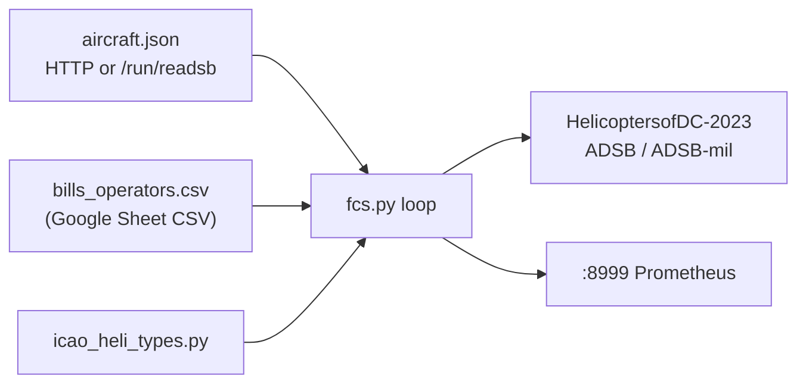

# FCS roadmap: review, brauhaus integration, heli-audio, and query API

**Status:** Planning (2026-10-23) — return to implementation later.  
**Repo:** LoganSound/CopterFeeder (`fcs.py`, v26.3.1, `CODE_DATE` 20260208).  
**Related brauhaus infra:** picm3 adsb.im feeder, stage2 VM (`192.168.64.147`), nobel vhost
`adsb.brauhausdc.org` → `/data/aircraft.json`, Mongo Atlas `HelicoptersofDC-2023` (`ADSB`,
`ADSB-mil`).

---

## 1. What FCS does today



| Step | Behavior |
| ---- | -------- |
| Input | `http://{SERVER}:{PORT}/data/aircraft.json` or local `/run/{dump1090,readsb,...}/aircraft.json` with `-r` |
| Heli gate | Requires **`t` in `icao_heli_types`** (~900 type strings) |
| Enrichment | Bills CSV (hex → operator); callsign from `flight`; reg from `r` or Bills |
| Freshness | Skips stale `seen_pos` vs poll interval (Compose: `-i 15`) |
| Output | GeoJSON `Feature` → MongoDB driver insert (preferred) or legacy HTTPS API |
| Metrics | Prometheus on **8999**; optional OTLP via `docker-entrypoint.sh` |

**Query gap:** Consumers today hit **MongoDB Atlas** directly, **Grafana** (feeder metrics),
or duplicate **aircraft.json** polling. There is no first-class HTTP API on FCS for
“helicopters near me in the last N minutes” or “active rotors for feeder X.”

---

## 2. Code review summary (2026-10-23)

### Strengths

- MongoClient pooling, SIGTERM cleanup, mil split (`dbFlags & 1` → `ADSB-mil`).
- Bills refresh on interval (`BILLS_TIMEOUT`, default 3600 s).
- Docker + kube dev/prod + buildx multi-arch.

### Issues to fix (when we implement)

| ID | Severity | Item |
| -- | -------- | ---- |
| R1 | Functional | Comments say **A7 / Bills** path; code only accepts **`t` in `icao_heli_types`**. Category A7 or Bills-only hex without matching `t` is dropped. |
| R2 | Bug | `-V` prints literal `{VERSION}` (missing `f` on format string). |
| R3 | Bug | `mongo_https_insert`: `HTTPError` path may reference undefined `response`. |
| R4 | Bug | `load_helis_from_url` success return may use stale `bills_age` instead of `tmp_bills_age`. |
| R5 | Ops | Dockerfile **HEALTHCHECK** calls `/health`; Prometheus `start_http_server` typically exposes **`/metrics` only**. |
| R6 | Security | `kube/prod/fcs-env-configmap.yaml` has **plaintext `MONGOPW`** in git — rotate, use **Secret**, scrub history if exposed. |
| R7 | Ops | `fcs_rx_msgs` labels **icao + callsign** — high cardinality on busy feeds. |
| R8 | Maintainability | ~2100-line monolith — hard to unit-test filter/insert logic. |

### Product decision (rotor filter)

When implementing, choose explicit rules, e.g.:

- `category == "A7"`, **or**
- `t in icao_heli_types`, **or**
- `t` prefix `H` (ICAO heli family), **or**
- hex present in Bills with rotor intent

Document the chosen rule in `AGENTS.md` and tests.

---

## 3. Brauhaus deployment (no local SDR required)

FCS can run anywhere that reaches the merged sky picture:

| Setting | Example |
| ------- | ------- |
| `FEEDER_ID` | `dhb-test`, `brauhaus-back40`, etc. (must match Grafana `_helifeeder`) |
| `SERVER` | `adsb.brauhausdc.org` |
| `PORT` | `80` |
| `MONGOUSER` / `MONGOPW` | Atlas user for `HelicoptersofDC-2023` (via Secret, not ConfigMap) |

**Colocated on picm3:** `-r` and mount ultrafeeder/readsb `aircraft.json` under `/run/...`.

**Remote (e.g. Back40 Pi, k8s):** HTTP URL only; same Mongo feeder id for correlation.

---

## 4. Helicopter **audio** fusion (separate from FCS, shared ADS-B)

Goal: combine **RTSP microphone** (e.g. Back40 UniFi) with **ADS-B** to label helicopter
passages and reduce false positives (BirdNET / custom ONNX).

| Layer | Role |
| ----- | ---- |
| **FCS** | Authoritative **track → Mongo** for HoDC map; hex, type, callsign, feeder, time, geometry |
| **Heli-audio service** (future repo e.g. `heli-audio`) | Audio pipeline + **correlator** keyed on time + feeder + optional distance |
| **BirdNET / Perch** | Weak “aircraft/engine” hints only; Perch has no dedicated helicopter class |

**Phase 1 correlator inputs (pick one or combine):**

1. Poll same `aircraft.json` as FCS (simplest).
2. Query Mongo by `properties.feeder` + `properties.jsDate` window (matches existing Grafana heatmaps).
3. **Future:** query **FCS Query API** (section 5) — preferred once API exists.

**Phase 2+:** ADS-B-assisted labeling (AeroSonic-style), custom ONNX, deploy via brauhaus
`multiarch-builder`.

**Note (pirak07 BirdNET):** Shorebird/screech-owl tuning is independent; keep mammals/amphibians
user wanted; FCS does not replace audio classifiers.

---

## 5. Proposed: **FCS Query API** (FastAPI)

### 5.1 Motivation

- **Heli-audio** and other clients need stable, documented HTTP access without Mongo wire protocol.
- **Read path** should not run in the hot ADS-B loop (avoid blocking inserts).
- **OpenAPI** enables codegen and agent tooling (MCP, scripts).

### 5.2 Recommended architecture

**Separate process (or container sidecar): `fcs-api`**

```
┌─────────────┐     insert      ┌──────────┐
│  fcs.py     │ ──────────────► │ MongoDB  │
│  (writer)   │                 │ Atlas    │
└─────────────┘                 └────▲─────┘
                                     │ read
                               ┌─────┴─────┐
                               │  fcs-api  │
                               │  FastAPI  │
                               │  :8080    │
                               └───────────┘
                                     ▲
                               heli-audio, Grafana
                               plugins, curl, agents
```

Optional **in-memory cache** in `fcs-api`: subscribe to periodic refresh of `aircraft.json`
(per feeder) for **live** “rotors in JSON now” without waiting for Mongo insert latency.

Do **not** fold heavy query logic into `fcs.py` loop; share library code via a small package
(e.g. `fcs_common/` or `src/feedcopterspotter/`) for filter rules and GeoJSON parsing.

### 5.3 Tech stack

| Piece | Choice |
| ----- | ------ |
| Framework | **[FastAPI](https://fastapi.tiangolo.com/)** + **Uvicorn** (already common in Python 3.12 images) |
| Mongo | **`motor`** (async) or sync **`pymongo`** in thread pool — match existing `fcs.py` driver usage |
| Config | Reuse `.env` keys: `MONGOUSER`, `MONGOPW`, `MONGO_URI` / cluster host; add `FCS_API_PORT`, `FCS_API_KEY` |
| Docs | Auto `/docs`, `/redoc`; export OpenAPI JSON for clients |
| Metrics | Prometheus `/metrics` on API (separate from FCS :8999) or single scrape target with labels |

Add to `requirements.txt` (or `requirements-api.txt` extra):

```text
fastapi>=0.115
uvicorn[standard]>=0.32
```

### 5.4 Endpoint sketch (v1)

All times ISO-8601 UTC; responses GeoJSON `FeatureCollection` unless noted.

| Method | Path | Purpose |
| ------ | ---- | ------- |
| `GET` | `/health` | Liveness + Mongo ping (fixes k8s health pattern for API container) |
| `GET` | `/ready` | Mongo + optional aircraft.json reachability |
| `GET` | `/v1/helicopters/recent` | Query params: `feeder`, `since` (duration or timestamp), `limit`, `mil=false\|true` |
| `GET` | `/v1/helicopters/{icao}` | Latest feature for hex (optional `feeder`) |
| `GET` | `/v1/helicopters/near` | `lat`, `lon`, `radius_km`, `since` — Mongo `$geoWithin` or `$near` on stored geometry |
| `GET` | `/v1/live/rotors` | Optional: filter current `aircraft.json` with **same rotor rules as FCS** (configurable URL per feeder) |
| `GET` | `/v1/meta/version` | FCS + API semver, `CODE_DATE` |

**Auth (v1):** API key header `X-API-Key` or query `key=` for public-ish deployment behind nobel;
stricter OAuth/mTLS only if exposed beyond LAN.

**Pagination:** `limit` + `cursor` (ObjectId or `jsDate` tie-break).

### 5.5 Data model notes

FCS inserts GeoJSON features with properties such as `feeder`, `icao`, `call`, `type`,
`jsDate`, `date`, altitudes, `rssi`. API should **not** reshape fields HoDC clients already
use; add `_api` metadata only if needed.

Index recommendations (Atlas): `{ "properties.feeder": 1, "properties.jsDate": -1 }`,
geospatial index on `geometry` if not already present.

### 5.6 Deployment

| Target | Pattern |
| ------ | ------- |
| Docker Compose | Service `fcs-api` alongside `fcs`; shared `.env` |
| Kubernetes | Deployment + Service + Ingress (TLS at nobel); **Secret** for Mongo; ConfigMap for URLs only |
| Brauhaus | e.g. `fcs-api.brauhausdc.org` CNAME → nobel, rate-limit at nginx |

**Heli-audio** should default to `FCS_API_BASE=http://fcs-api:8080` with fallback to
`aircraft.json` if API down.

### 5.7 Implementation phases

| Phase | Deliverable |
| ----- | ----------- |
| **A** | Package layout + shared `rotorcraft_filter()` extracted from `fcs.py`; fix R1–R5 in writer |
| **B** | Minimal FastAPI: `/health`, `/v1/helicopters/recent`, Mongo read-only user |
| **C** | `/v1/live/rotors`, `/v1/helicopters/near`, OpenAPI published in repo |
| **D** | k8s/Compose, Grafana dashboard panel linking API, heli-audio correlator uses API |
| **E** | Optional write endpoints (admin only) — **out of scope** unless HoDC needs feeder-originated deletes |

### 5.8 Testing

- **pytest** + **httpx** `AsyncClient` against FastAPI app.
- Fixture Mongo (or testcontainers) with sample features from `fcs.py` output.
- Contract test: live rotors filter matches `fcs.py` on frozen `aircraft.json` snippet.

---

## 6. Implementation log

| Date | Change |
| ---- | ------ |
| 2026-10-23 | Initial planning doc from agent review (FCS, brauhaus, heli-audio, FastAPI API concept). |
| 2026-10-23 | **Land:** `docs/planning/*`, `AGENTS.md` → [CopterFeeder `25a9ad6`](https://github.com/LoganSound/CopterFeeder/commit/25a9ad6) on `main`. |
| 2026-10-23 | **Resume bookmark:** [cursor-agent `17db656`](https://github.com/brauhausdc/cursor-agent/commit/17db656) — `scripts/resume/agent_resume_20261023_d39d190b.sh`. |

_Add rows when implementation PRs land._

---

## 7. References

- CopterFeeder: `README.md`, `AGENTS.md`, `kube/README.md`
- Skill: `.cursor/skills/adsb-feeder-healthcheck/` (Mongo feeder last-seen)
- Brauhaus ansible/docs: copterfeeder vars, `adsb.brauhausdc.org`, stage2, picm3 `/opt/adsb`
- BirdNET pirak07: local `/opt/docker/birdnet` config (separate from this repo)
